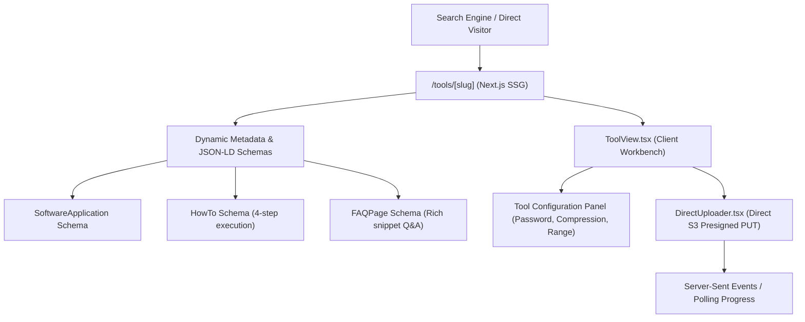

# Phase 04: Public Website Shell & Dynamic Page Builders

## 1. Overview
Phase 04 implements the public marketing and tool execution website for SimplifyPDF (`apps/web`). It delivers an SEO-optimized public portal with:
- **Interactive Tool Workbenches**: 14+ specialized PDF tools with dynamic slug routing (`/tools/[slug]`).
- **Dynamic Structured Data**: High-fidelity JSON-LD schemas (`SoftwareApplication`, `HowTo`, `FAQPage`, and `BreadcrumbList`) rendered per tool to maximize organic Google search prominence.
- **Content Marketing Engine**: Static blog directory (`/blog`) and article templates (`/blog/[slug]`) pre-rendering deep educational guides on PDF compression, redaction security, and permissive engine licensing.
- **Search Engine Discovery**: Dynamic `sitemap.xml` and `robots.txt` indexing public landing and tool pages while blocking internal administrative, portal, and API routes.
- **Trust & Architecture Showcase**: Dedicated `/security` page detailing zero-retention auto-shredding, 256-bit AES encryption, cryptographic audit trails, and strict AGPL-free permissive open-source stack.

---

## 2. Dynamic Tool Architecture (`/tools/[slug]`)
Each tool is statically pre-rendered via `generateStaticParams()` at build time and served through an interactive client workbench:

### Pre-rendered Tool Slugs:
1. `compress`: Multi-tier PDF compression (Pillow / pikepdf).
2. `merge`: Combine multiple documents into one.
3. `split`: Page range extraction and file splitting.
4. `protect`: AES-256 military-grade encryption with owner/user passwords.
5. `unlock`: Clean password removal and document decryption.
6. `ocr`: Searchable PDF/A conversion using OCRmyPDF + Tesseract.
7. `esign`: Cryptographic digital signature placement with audit certificate.
8. `redact`: Permanent vector/content stream redaction and metadata stripping.
9. `pdf-to-word`: Docx conversion using permissive pdf2docx.
10. `pdf-to-excel`: Spreadsheet table extraction.
11. `pdf-to-jpg`: High-res 300 DPI image rendering via pypdfium2.
12. `jpg-to-pdf`: Fast image packaging into standardized PDF.
13. `rotate`: Orientation normalization (90/180/270 degrees).
14. `organize`: Reorder, delete, and duplicate PDF pages.

---

## 3. SEO & Structured Data Implementation
### JSON-LD Specifications
- **`SoftwareApplication`**: Categorizes each tool as `MultimediaApplication`, rating 4.9/5, specifies free/pro price tiers, and lists operating systems.
- **`HowTo`**: Details 4 actionable steps:
  1. Select and upload target PDF document.
  2. Configure tool settings (e.g., compression ratio, password).
  3. Processing in private zero-retention worker sandbox.
  4. Instant download of processed document.
- **`FAQPage`**: 4 comprehensive Q&A pairs per tool answering safety, cost, limitations, and retention policies.

### Sitemap & Robots Directives
- **`sitemap.ts`**: Automatically compiles dynamic URLs for home, security, pricing, all 14 tools, and all published blog posts with accurate `changeFrequency` and `priority` attributes.
- **`robots.ts`**:
  - `Allow: /`
  - `Disallow: /api/`, `/admin/`, `/app/`
  - Canonical `sitemap` reference pointing to `https://simplifypdf.com/sitemap.xml`.

---

## 4. Nuvexa Styling & Component Compliance
- **Vertical Roll Buttons (`.btn-v6`)**: Primary CTAs styled with deep purple `#864FFE` gradient, 100% pure white text (`#FFFFFF`), and smooth cubic-bezier vertical text rolling animations.
- **Lateral Sliding Pills (`.nextsaas-btn`)**: Secondary navigational CTAs with pill radius (`rounded-full`) and hover arrow displacement.
- **Strict Accessibility**: Contrast ratios exceeding WCAG AA standards across both light (`#FAF9F7`) and dark (`#0B0B10`) palettes.
