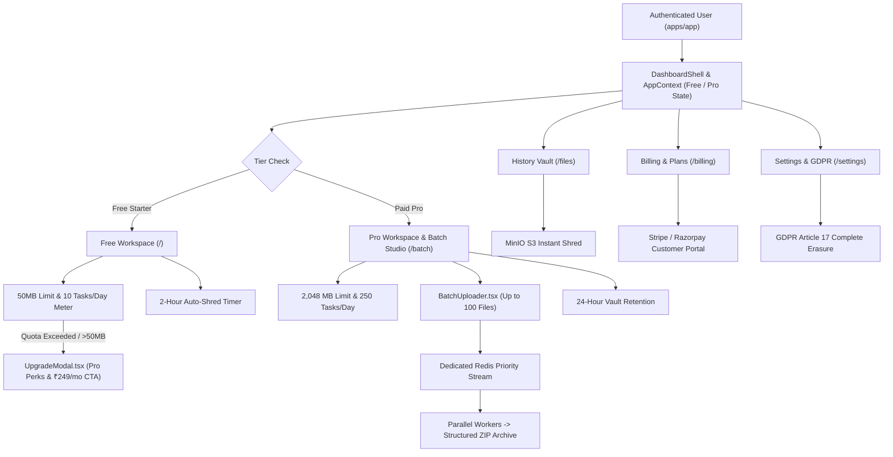

# Phase 05: User Dashboards & Workspaces (Free & Paid)

## 1. Overview
Phase 05 establishes the authenticated user portal (`apps/app`) differentiating workflows between **Free Starter** members and **Paid Pro** subscribers:
- **Free Member Tier**:
  - Maximum 50 MB per file.
  - Daily quota meter capped at 10 tasks/day (resets at 00:00 UTC).
  - 2-hour zero-retention auto-shredding countdown with instant manual wipe.
  - Quick-action document conversion dropzone with real-time file size threshold guards.
  - Dynamic Pro upgrade triggers upon approaching quota or dropping files >50 MB.
- **Paid Pro Member Tier**:
  - 2,048 MB (2 GB) file capacitor with direct presigned S3 parallel chunking.
  - Multi-File Batch ZIP Studio (`BatchUploader.tsx`) processing up to 100 documents simultaneously across dedicated parallel workers.
  - Consolidated structured ZIP archive export for one-click downloading.
  - Dedicated worker pool routing indicator: `⚡ Priority Queue Routing Active`.
  - 24-hour retention vault with instant GDPR manual shredding.
- **Account Operations & Security**:
  - History Vault (`/files`): Real-time countdown timers, original/compressed size efficiency, and signed S3 download links.
  - Billing & Invoices (`/billing`): Active plan overview, Stripe / Razorpay Customer Portal integration, and VAT/GST invoice downloads.
  - Settings & GDPR Erasure (`/settings`): Profile credentials, Two-Factor Authentication (2FA), and GDPR Article 17 "Right to Erasure" permanently expunging user records, S3 objects, and active sessions.

---

## 2. Architecture & Flow Diagram

---

## 3. Component & Route Breakdown

| Path | Purpose | Key Features |
| :--- | :--- | :--- |
| `apps/app/components/DashboardShell.tsx` | Global Application Layout & Context | Sidebar navigation, role switcher (`FREE` vs `PRO`), priority queue badge, theme preservation |
| `apps/app/components/UpgradeModal.tsx` | Conversion & Upsell Modal | 6 core Pro benefits, instant monthly/annual toggle, ₹249 / $4.99 price display |
| `apps/app/components/BatchUploader.tsx` | Multi-File Batch Studio | Drop up to 100 files, 2GB capacity meter, parallel worker simulation, consolidated ZIP export |
| `apps/app/app/page.tsx` | Main Workspace Dashboard | Daily tasks meter, file capacitor card, auto-shred timer, quick dropzone, recent files |
| `apps/app/app/batch/page.tsx` | Dedicated Batch ZIP Studio | Pro crown badge, priority routing tag, batch compress/convert/protect actions |
| `apps/app/app/files/page.tsx` | History Vault | Document listing, compression savings %, live auto-shred countdown, instant purge |
| `apps/app/app/billing/page.tsx` | Subscription & Billing | Active plan status, renewal dates, Stripe portal link, tax invoice downloads |
| `apps/app/app/settings/page.tsx` | Account & Security | Profile editing, password change, 2FA toggle, GDPR Article 17 irreversible wipe |

---

## 4. Nuvexa Styling & Design System Compliance
- **Primary Buttons (`.btn-v6`)**: Pure white text (`#FFFFFF`) with Nuvexa violet `#864FFE` background and vertical rolling hover effect.
- **Secondary Pills (`.nextsaas-btn`)**: Rounded full pill radius with lateral hover arrow displacement.
- **Palette**: Strictly adhered to Nuvexa tokens:
  - Primary 500: `#864FFE`
  - Primary 700: `#6D1FE2`
  - Secondary: `#1A1A1C`
  - Accents: Lime `#C6F56F`, Yellow `#F9EB57`, Cyan `#83E7EE`
