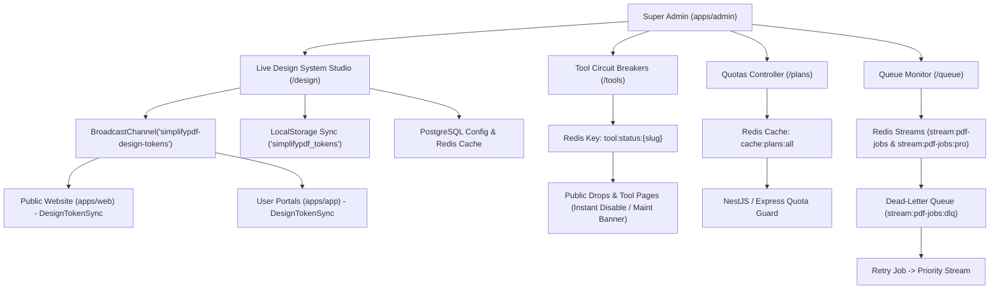

# Phase 06: Admin Command Center — Core Operations & Live Design System Studio

## 1. Overview
Phase 06 establishes the centralized administrative headquarters (`apps/admin`) for SimplifyPDF. It gives administrators full real-time operational control, observability, monetization configuration, and token manipulation:
- **Executive Command Center (`/`)**: 5-KPI real-time health rail, daily conversion volume breakdown by tool type, multi-currency revenue trajectory (Razorpay INR + Stripe USD).
- **PDF Tool Circuit Breakers (`/tools`)**: Instant ON/OFF master toggles, maintenance mode with customizable user advisories, and plan-specific visibility stored in Redis keys `tool:status:{slug}`.
- **Tier & Quotas Controller (`/plans`)**: Dynamic capacity limits editor (max file size, daily task ceilings, batch file limit, vault retention hours, OCR monthly allowances) and grandfathering engine.
- **User Management & Support (`/users`)**: Searchable user directory with inspection drawer, manual Pro VIP grants, account suspension with immediate JWT session revocation in Redis, and GDPR Article 17 "Right to Erasure" triggers.
- **Billing & Subscriptions Console (`/billing`)**: Multi-currency MRR overview, audited refund triggers with automated plan tier downgrades, and promotional discount coupon generator.
- **Redis Queue Monitor & DLQ Inspector (`/queue`)**: Depth monitoring for `stream:pdf-jobs` and `stream:pdf-jobs:pro`, container CPU/RAM consumption, LibreOffice concurrency lock semaphore (Limit: 1), and dead-letter queue (DLQ) retry console.
- **Administrative Audit Trail (`/audit`)**: Append-only immutable log recording all admin operations with timestamp, actor, origin IP, and before/after JSON diffs, exportable to CSV.
- **Live Design System Studio (`/design`)**: Real-time CSS design token manipulation (Nuvexa violet `#864FFE`, secondary `#1A1A1C`, lime `#C6F56F`, border radius) broadcasting across all open windows via `BroadcastChannel`, `localStorage`, and `postMessage`, instantly updating the public website and user portal without redeployments.

---

## 2. Real-Time Architecture Diagram

---

## 3. Administrative Modules & Capabilities

| Path | Module | Capabilities |
| :--- | :--- | :--- |
| `/` | Executive Overview | Active visitors, blended MRR, tasks today, free-to-paid conversion rate, worker error rate |
| `/tools` | Tool Circuit Breakers | Instant kill-switch, maintenance banner toggle, plan tier visibility (Guest/Free/Pro) |
| `/plans` | Quotas & Tiers | Max file MB (25/50/2048), daily tasks, retention hours, OCR pages, grandfathering engine |
| `/users` | User Directory | User search, inspection drawer, daily quota reset, manual Pro VIP grants, GDPR erasure |
| `/billing` | Gateway Billing | Invoices, Stripe & Razorpay MRR breakdown, audited refunds, discount coupon engine |
| `/queue` | Queue & Worker Health | Stream depth, container CPU/RAM, LibreOffice semaphore (1/1 lock), DLQ retry/purge |
| `/audit` | Audit Log | Append-only audit records, JSON diff payloads, CSV export |
| `/design` | Live Design Studio | Nuvexa palette tokens, vertical roll buttons, pill radius, cross-tab live broadcast |

---

## 4. Nuvexa Styling & Accessibility Rules
- **Primary Action Buttons (`.btn-v6`)**: Pure white text (`#FFFFFF`) with Nuvexa violet `#864FFE` background and vertical rolling hover animation.
- **Secondary Action Buttons (`.nextsaas-btn`)**: Rounded full pill radius with lateral hover arrow displacement.
- **Accessibility**: 100% WCAG AA contrast compliance across light (`#FAF9F7`) and dark (`#0B0B10`) modes.
