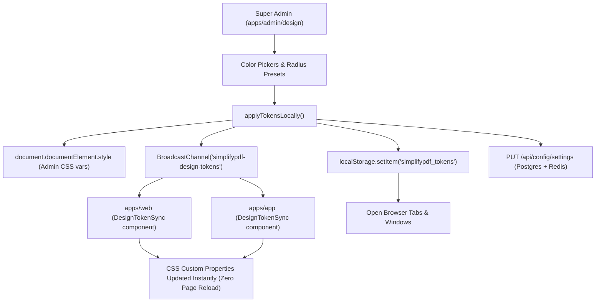

# Phase 07: Admin Website Builders & Live Design System Studio

## 1. Overview
Phase 07 establishes the visual content authoring and brand styling suite (`apps/admin/app/builders/` and `apps/admin/app/design/`). It empowers administrators to manage all customer-facing marketing copy, navigation menus, homepage layout sections, custom pages, blog guides, and global design tokens with zero code deployments or server restarts:
- **Shared Builder Framework (`BuilderEngine.tsx`)**: Reusable wrapper powering all builders with responsive viewport switching (Mobile 375px, Tablet 768px, Desktop 1280px), live interactive iframe preview, version rollback, and S3 media library modal.
- **Header & Navigation Builder (`/builders/header`)**: Brand logo settings, custom menu hierarchy, tool mega-menu categorization, and `.btn-v6` rolling CTA button settings with guaranteed pure white text (`#FFFFFF`).
- **Footer Builder (`/builders/footer`)**: 4-column navigation links manager, dynamic copyright line with `{YEAR}` replacement, social networks, and trust certifications (SSL, GDPR, DPDP).
- **Notification Bar Builder (`/builders/notification-bar`)**: Global announcement bar with emoji support, scheduled campaign start/end dates, background presets (Nuvexa violet, near-black, emerald, amber), and 7-day dismissible client cookie controls.
- **Homepage Sections Builder (`/builders/homepage`)**: Drag-and-drop section reordering across all 11 homepage blocks, visibility toggles, hero copy editor, and automatic `FAQPage` JSON-LD schema generation.
- **Custom Pages & Legal Builder (`/builders/pages`)**: Dynamic page manager (`/security`, `/about`, `/terms`, `/privacy`) with slug collision validation, rich markdown editor, SEO meta tags, and header/footer placement checkboxes.
- **Blog Builder (`/builders/blog`)**: Article authoring studio with category taxonomies, Unsplash cover photo integration, live Google search snippet simulation, and scheduling controls.
- **Live Design System Studio (`/design`)**: Real-time CSS token manipulation (Nuvexa Violet `#864FFE`, Hover `#6D1FE2`, Secondary `#1A1A1C`, Lime `#C6F56F`, Cyan `#83E7EE`, Yellow `#F9EB57`, and corner radius presets `6px`, `12px`, `16px`, `24px`) broadcasting across browser tabs via `BroadcastChannel`, `localStorage`, and `postMessage`.

---

## 2. Real-Time Token Sync & Propagation Architecture

---

## 3. Builder Module Directory

| Route | Builder Tool | Target Output & Invalidation |
| :--- | :--- | :--- |
| `/builders/header` | Header & Navigation | Mega-menu tools, logo, `.btn-v6` roll CTA; invalidates `cache:config:header` |
| `/builders/footer` | Footer & Columns | 4 link columns, `{YEAR}` copyright, trust certifications; invalidates `cache:config:footer` |
| `/builders/notification-bar` | Notification Banner | Announcement banner, scheduling, dismissible cookie; invalidates `cache:config:notification-bar` |
| `/builders/homepage` | Homepage Sections | Block reordering (Hero, Dropzone, Pricing, FAQ); invalidates `cache:config:page:home` |
| `/builders/pages` | Custom & Legal Pages | Dynamic routes (`/security`, `/about`, `/terms`); invalidates `cache:config:page:{slug}` |
| `/builders/blog` | Blog & SEO Guides | Long-tail guides, Google snippet preview, author metadata; invalidates `cache:config:blog:{slug}` |
| `/design` | Live Design System Studio | Nuvexa palette tokens, button styles, corner radiuses; hot-broadcasts across all portals |

---

## 4. Nuvexa Component Compliance
- **Button Rolling Animations (`.btn-v6`)**: Primary CTAs styled with deep purple `#864FFE` gradient, 100% pure white text (`#FFFFFF`), and smooth vertical text rolling animations on hover.
- **Pill Action Buttons (`.nextsaas-btn`)**: Secondary navigational CTAs with pill radius (`rounded-full`) and hover arrow displacement.
- **Accessibility**: 100% WCAG AA contrast compliance across light (`#FAF9F7`) and dark (`#0B0B10`) modes.
